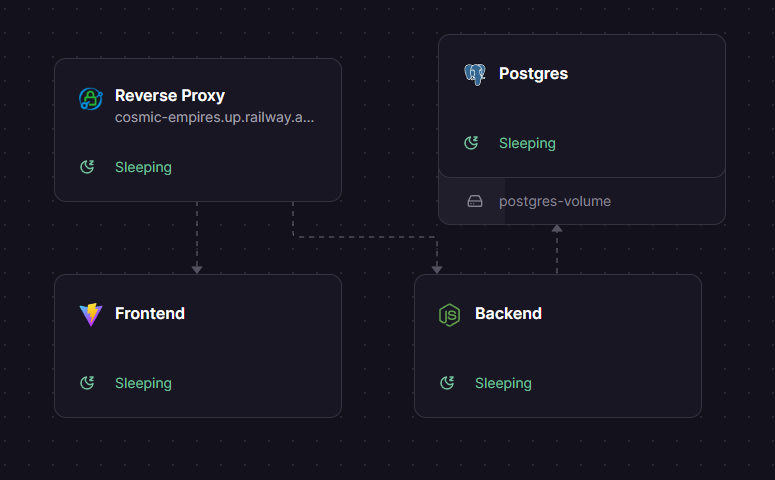

# System architecture

Cosmic Empires has a React frontend and an Express backend in a TypeScript pnpm workspace. A reverse proxy serves both applications on the same origin. The backend stores game state in Postgres and hosts the Turn Processing worker. Isolating the worker allows it to scale separately or move to another runtime later.



| Area                                          | Responsibility                                                         |
| --------------------------------------------- | ---------------------------------------------------------------------- |
| [Frontend](packages/frontend/ARCHITECTURE.md) | Web application.                                                       |
| [Backend](packages/backend/ARCHITECTURE.md)   | Frontend API, persistence, and Turn Processing.                        |
| [Shared](packages/shared/ARCHITECTURE.md)     | Domain definitions and gameplay behavior used by both applications.    |
| [Infrastructure](infra/ARCHITECTURE.md)       | Development database and reverse proxy configuration.                  |
| [Railway](.railway/ARCHITECTURE.md)           | Deployment configuration. Merges to main deploy the affected services. |

## Package boundaries

```
packages/frontend/ ──▶ packages/shared/ ◀── packages/backend/
packages/frontend/ ──type-only API contracts──▶ packages/backend/src/api/types.ts
packages/backend/src/api/ ───▶ packages/backend/src/turn-processing/
```

Across workspace projects, runtime imports from the apps may only target shared packages. The frontend may access the backend only through the API contract types described below. The backend must not import from the frontend, and shared packages must not import from either app, including type-only imports.

- Import named backend contract types with `import type` from `@api-types`. Do not use indexed access to extract nested API types in frontend code, or unroll/reconstruct their shapes locally.
- When a needed contract type is missing, add a named export in `packages/backend/src/api/types.ts` derived from the tRPC router output (`inferRouterOutputs<TrpcRouter>`). Derive nested types there as well, so the frontend uses the actual API output type despite Zod inference quirks.
- Import shared domain types with `import type` directly from the shared modules that define them.
- The frontend owns types for component state, rendering, and interactions.

See [ADR-007](docs/architecture/decisions/007-code-sharing.md) and [ADR-022](docs/architecture/decisions/022-frontend-api-contract-types.md).

IDs for entities within a game are strings in storage, domain models, API contracts, and the frontend. `GameId` itself may be numeric. See [ADR-030](docs/architecture/decisions/030-use-string-ids-for-game-entities.md).

## Toolchain

The workspace has one root lockfile. Install dependencies from the root. pnpm manages the pnpm and Node versions through `package.json` devEngines. The project uses TypeScript 7, oxfmt and Oxlint. See [ADR-014](docs/architecture/decisions/014-pnpm-workspaces-and-shared-railway-monorepo.md).

The team chose familiar tools (TypeScript, React, Express, pnpm workspaces and TanStack Query) to limit how much it had to learn while adopting TanStack Router, Drizzle, Clerk, Railway and Postgres. The workspace uses pnpm directly.

Every service parses its environment variables with a Zod schema early at startup. This documents required settings and validates the service configuration.

## Postgres versions

Postgres 18.4 is used across environments. When updating it, update the development [Compose file](infra/docker-compose.yaml), the production Postgres image, the [concurrency test image](packages/backend/src/testing/POSTGRES_IMAGE.ts), and the [GitHub Actions service](.github/workflows/ci.yml).
