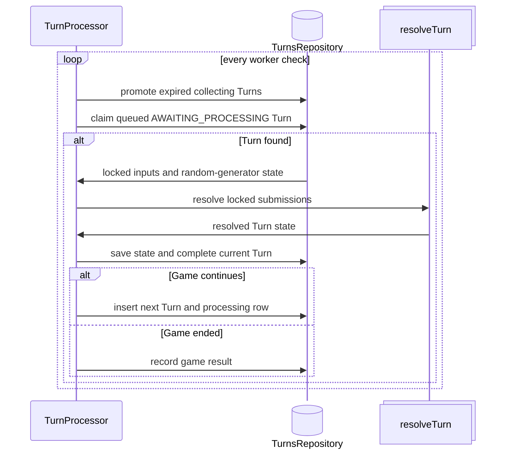

# Turn processing

Turn Processing is the process via which turns that must be resolved are found and sent for resolution at the right time. This is different from Turn Resolution because it is game agnostic.

The backend worker in `apps/backend/src/turn-processing` owns Turn scheduling, persistence, and orchestration. The shared [Turn Resolution](turn-resolution.md) code in `packages/shared/src/turn-resolution` owns deterministic resolution of the locked Action Submissions. This separation follows [ADR 011](./decisions/011-turn-processing-in-worker-thread.md) and [ADR 007](./decisions/007-code-sharing.md).

The turn processing pipeline doesn't know much about how turns are resolved. It only knows what data to supply to the `resolveTurn` function and how to handle the state that comes out.

## Current orchestration

1. `TurnProcessor` works on 2 tables: `turnsTable` and `turnsProcessingTable`. When a turn is created, a row is inserted in both tables immediately.
1. `TurnProcessor` promotes closed Turns rows from `COLLECTING_ACTIONS` to `AWAITING_PROCESSING`. Turns can also be closed and their scheduling updated by unanimous Readiness via the `apps/backend/src/api/`.
1. Through `TurnsRepository`, the worker claims a turnsProcessing row by locking the row, moves the Turns row to `PROCESSING`, and loads its locked submissions, game state and random-generator state.
1. The worker then unlocks the turnsProcessing row after setting the processing startDate, which prevents other workers from processing it.
1. The worker calls `resolveTurn` with those inputs. The Turn Resolution revalidates submissions and resolves them.
1. On success, the worker saves the resulting game state and moves the Turn to `COMPLETED`. If the game continues, it creates the next Turn and its processing queue row, otherwise it records the game as ended.

The diagram shows the successful resolution path. Failure-mode policy reconciliation remains tracked in [#433](https://github.com/Guillaume-Docquier/text-based-browser-game-1/issues/433).

