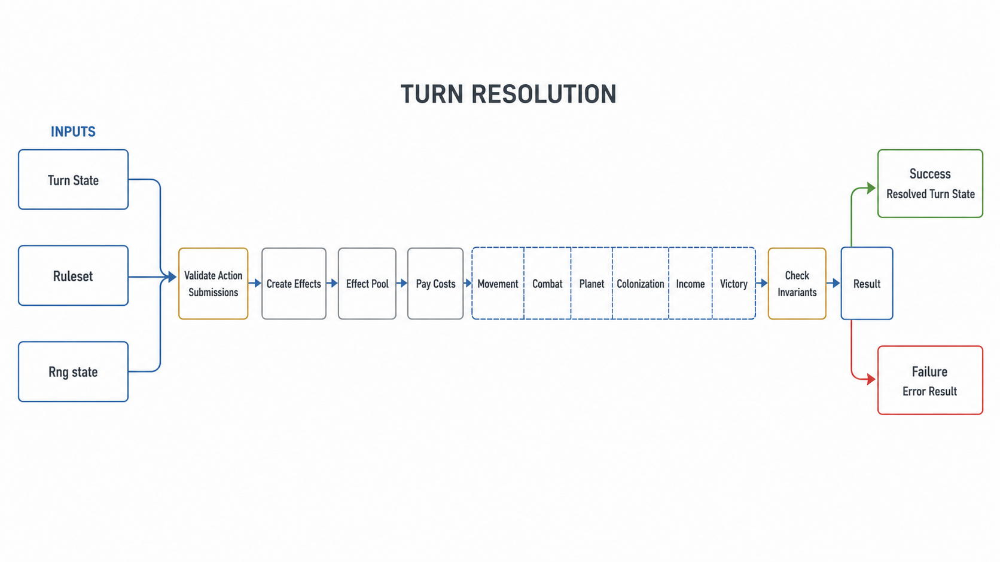
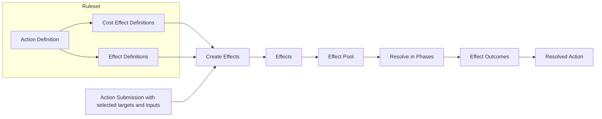
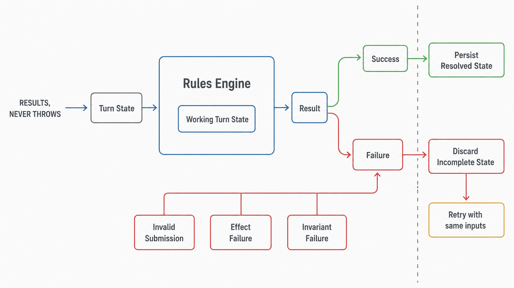

# Turn Resolution

Game turns are resolved in `packages/shared/src/turn-resolution`, using the shared domain definitions and action-submission validators.

Turn Resolution is data driven via a Ruleset. The mechanics of the game, called Effects, and the resolution Phases are baked in the turn-resolution code, but the set of available actions and the target constraints are decided by the Ruleset, which is subject to validation before persistence. The backend owns the Standard Ruleset and any other official Rulesets. The shared package owns an independent and stable Test Ruleset under `packages/shared/src/testing/test-ruleset`.

The Rules Engine works by converting Actions Submissions into their corresponding Effects that are resolved in Phases.

Actions compose Effect Definitions stored in the Ruleset. During Turn Resolution, each Effect Definition creates an Effect. This allows Actions to reuse supported behavior.

Because Turn Resolution is data driven and persistence agnostic, we could play games entirely offline, in the terminal, for example. We had a version of this, but it was cumbersome to maintain, and we're very well-equipped to test this easily via unit tests, integration tests and end-to-end tests.

## Ruleset

The Turn Resolution defines clear models to define Actions. The Ruleset and its Actions are entirely data driven, building on the game's supported Effects.

The Turn Resolution owns the Ruleset model, the supported Effect Definitions and the Phase ordering and Effect resolution.

This means that creating Actions and balancing the game is nearly free, and multiple concurrent games can use different Rulesets. Adding effect definitions is also quite easy.

However, it also means that removing Effect Definitions entirely or changing how Effects are resolved is a breaking change that should be reviewed carefully. At a later stage, we will probably have to introduce engine versioning to support multiple engines.

When we support multiple engines, we will probably prevent games from starting with old engine versions so that we can get rid of the code once all games running on that version are over. It's also possible that we keep multiple engines, but we'd highly prefer supporting a single engine and many Rulesets than supporting many engines.

## Determinism

The rules engine is deterministic. Given the same Rng state, Turn State and Ruleset, the results will always be identical. This is important for testing and reproducibility.

## Failure modes

The Rules Engine never throws, even for failed invariant checks. It always returns Results. This is because the Rules Engine will be used on a worker, and the Rules Engine state is confined to its inputs. Fatally throwing then crashing here would cause the worker to fully restart, which costs an unnecessary downtime and higher memory usage. Aborting the process this way will not clear any corrupted data, as the Rules Engine will not rely on process wide data to clean up.

Because of this, the use of the `Assert` module is not permitted there.

## Validation

All action submissions are validated before any resolution starts. Any invalid action fails the turn. Every action is expected to have been validated already on submission using the same shared eligibility evaluator. Draft, complete-set and candidate evaluations use total resources, game-scoped entities, cumulative costs and source Strength allocations. Replacement excludes the prior player/instance allocation. The API holds the Turn lock while evaluating the entire proposed set; the frontend projects the same state shape.

A failed turn state is expected to not be persisted, as the turn resolver stopped at the first error and the state is probably incomplete.

If any Effect fails to process at a later time, for any reason, then the turn will also be failed. Passing the validation should ensure that every Action will be able to resolve correctly, so if an Effect cannot properly resolve, it will be treated as fatal and fail the turn.

## Turn Context

The Turn Context is what every Effect will work on. It notably contains the Turn State to mutate and the Effect Pool to draw Effects from.

### Turn State

Every Effect mutates the Turn State, for simplicity and performance.

### Effect Pool

Effects are added and picked from the Effect Pool.

Effect resolution in the Effect Pool is handled by the Effect base class to ensure every call to `effect.resolve()` is recorded.

## Pipelines

The Rules Engine is structured as a series of generic pipelines:

- turn pipeline
- validation pipeline
- phases pipeline

### Turn Pipeline

The turn pipeline is the highest level. It orchestrates the high level concepts within a turn:

- Initialization
- Action Validation
- Effect Creation
- Effect Resolution Phases
- Invariant Checks
- Assembling the final state

### Validation Pipeline

The validation pipeline handles validating action submissions for any data that could be corrupted or inconsistent:

- Action Definition Mappings
- Action Target Mappings
- Action Costs Eligibility

### Phases Pipeline

The phases pipeline handles Effect resolution:

- Pay Costs
- Fleet Movement
- Fleet Builds
- Fleet Combat
- Planet
- Colonization
- Income
- Victory

Effects can be added to the Effect pool through other Effects during the Phases.

After all phases are done, we expect all effects to have been resolved.

## Fleet journeys

Movement input/effect and source/range constraints are declarative Ruleset data. The Fleet Movement Phase creates all deterministic child departures before advancing old and new journeys once by their saved speed. Positive remainders preserve source identity; zero sources and merged children are removed. Friendly stationed merge preserves its identity. Journey records retain the initiating submission, Turn and speed, and occupy that player/Action instance until terminal cleanup. Saved journey integrity checks bind the existing definition, pooled instance, mapped selections and deterministic child identity before continuation. Before any departure, saved route endpoints and remaining distance must agree exactly with the canonical route-length, saved-speed and elapsed-Turn calculation; inconsistent progress fails rather than being overwritten. These checks do not recheck departure eligibility or require an exhausted source Fleet to remain. Saved speed remains authoritative when the current definition speed changes. Costs apply to new locked submissions only. The current Effect completes at departure; continuation is persisted game state rather than an unresolved pool Effect. Arrival candidates are computed before landing and processed in ascending Tick batches, with canonical semantic ties. Persisted indexed pending Assaults activate only after arrival in Fleet Combat. Separate per-order arrival intents retain original provenance and Tick while friendly merges redirect actual Fleet identity. Normal Assault snapshots the current survivor and all stationed opponents, applies exact proportional whole losses and deletes zero Fleets. Prior valid destruction produces explanatory Prevented outcomes. Saved fleet/pending integrity is checked before Pay Costs.

Outcome groups use initiating Turn, Player ID and Action ID rather than object identity. Resolved Actions contain initiatingTurn and only the current resolution's outcome deltas, including prior-turn arrivals with no current submissions. Completed outcome history is not persisted by the worker.

## Colonization

The bounded pending-arrival union is `ASSAULT | COLONIZE`, with original effect indexes, mapped definitions and submission provenance. Combat filters Assault; Colonization filters Colonize. Stationary Colonize registers Tick-0 intents before departures. Both variants validate post-Combat current Fleet identity, ownership, location and configured Strength. Known destruction is Prevented; unknown or corrupt bindings fail before costs. Canonical eligible-only competition is grouped by Tick then Planet ID and uses the persisted RNG. Successful effects replace the keyed readonly Planet value and consume the requirement once, deleting zero Fleets. Outcome grouping retains the immutable originating submission while merges redirect the actual Fleet identity.
